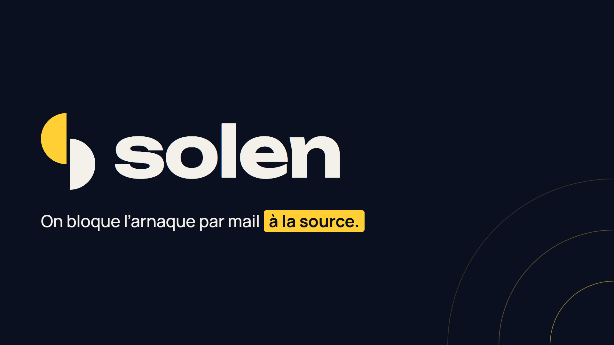

# Solen

[](https://github.com/barrage75/solen/actions/workflows/ci.yml) [](solen/src/redteam/cases.ts)  

[](https://solen-demo.vercel.app)

Solen est une extension de boîte mail qui détecte les arnaques par mail (faux changement de RIB, fraude au président, faux conseiller bancaire, hameçonnage, faux support informatique, domaines sosies) et explique la fraude à l'utilisateur en français. Le code décide dès que de l'argent est en jeu ; l'IA (Mistral) comprend et explique, ne voit jamais un IBAN et ne peut qu'aggraver le verdict.


Maquette de démonstration réalisée pendant le hackathon Finaxys « Build What's Next », les 23 et 24 octobre 2026. Toutes les données sont fictives et la démo n'a aucun lien avec Microsoft.

## Essayer la démo

En ligne, sans rien installer : **https://solen-demo.vercel.app**. Une visite guidée animée se lance à l'ouverture.

En local, l'application Next.js se trouve dans le dossier [`solen/`](solen/).

```bash
cd solen
npm install
npm run dev            # http://localhost:3000
```

Sans clé Mistral, les analyses de secours prennent le relais pour les mails de démo.

## La diapo

[](diapo/Solen-diapo-hackathon.pdf)

Le diaporama présenté au jury, en 4 diapositives : [ouvrir le PDF](diapo/Solen-diapo-hackathon.pdf).

## En savoir plus

Le [README du projet](solen/README.md) détaille :

- qui décide quoi entre le code, l'IA et les humains ;
- les 28 attaques contre lesquelles Solen est testé ;
- l'installation sous Windows, Mac et Linux, avec ou sans clé Mistral ;
- les raccourcis, les tests et la mise en ligne ;
- les limites actuelles et la suite.
