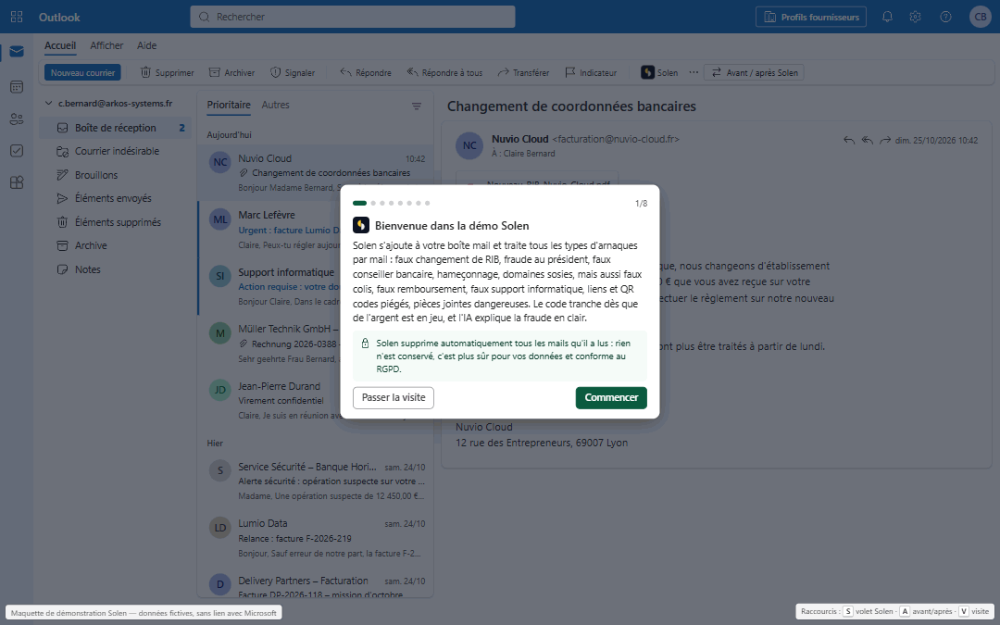
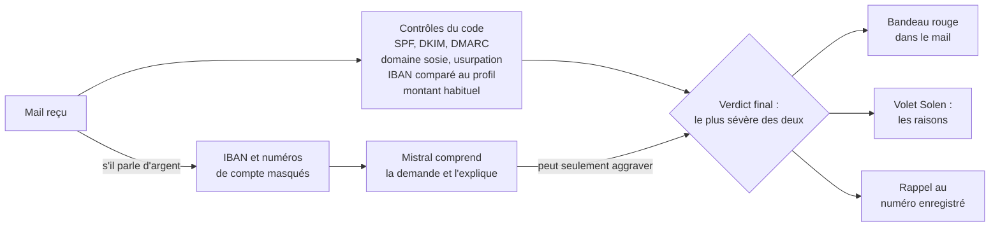

# Solen

[](https://github.com/barrage75/solen/actions/workflows/ci.yml) [](https://solen-demo.vercel.app/attaques)  

[](https://solen-demo.vercel.app)

[English version](README.en.md)

Solen est une extension de boîte mail qui détecte les arnaques par mail (faux changement de RIB, fraude au président, fraude à la paie, cartes cadeaux, faux conseiller bancaire, faux colis, faux remboursement d'impôt, fausses factures, pièces jointes et QR codes piégés, hameçonnage, domaines sosies) et explique la fraude à l'utilisateur en français. Le code décide dès que de l'argent est en jeu ; l'IA (Mistral) comprend et explique, ne voit jamais un IBAN et ne peut qu'aggraver le verdict.



Maquette de démonstration réalisée pendant le hackathon Finaxys « Build What's Next », les 23 et 24 octobre 2026. Toutes les données sont fictives et la démo n'a aucun lien avec Microsoft.

## Points forts

- **Le code décide, l'IA explique.** Authentification de l'expéditeur (SPF, DKIM, DMARC), domaines sosies, usurpation d'un dirigeant, contrôle de l'IBAN et du montant : ce sont des règles TypeScript. Le verdict de l'IA peut seulement relever l'alerte, jamais la baisser.
- **L'IA ne voit jamais un IBAN.** Les IBAN et numéros de compte sont remplacés par des jetons avant tout envoi à Mistral.
- **28 attaques rejouées à chaque test.** IBAN cachés, lettres cyrilliques dans un domaine, consigne en blanc sur blanc dans un PDF, faux en-têtes d'authentification, PDF corrompus, conversations détournées. Les tests remplacent l'IA par une IA piégée qui répond toujours « fiable », et vérifient que le code bloque quand même chaque attaque. Vous pouvez les voir rejouées en direct sur la page [28 attaques](https://solen-demo.vercel.app/attaques).

## Comment Solen décide



Le code tranche dès que de l'argent est en jeu. L'IA ne voit jamais un IBAN, et son avis ne peut jamais adoucir le verdict du code.

## Essayer la démo

En ligne, sans rien installer : **https://solen-demo.vercel.app**. Une visite guidée animée se lance à l'ouverture. Le bouton FR / EN de l'en-tête passe toute la démo en anglais, et le lien https://solen-demo.vercel.app/?lang=en l'ouvre directement en anglais.

Vous pouvez aussi **tester votre propre mail** sur la page [Tester un mail](https://solen-demo.vercel.app/essayer) : vous jouez l'attaquant, avec des exemples prêts à modifier, et Solen l'analyse avec le même volet que dans la boîte mail.

En local, l'application Next.js se trouve dans le dossier [`solen/`](solen/).

```bash
cd solen
npm install
npm run dev            # http://localhost:3000
```

Sans clé Mistral, les analyses de secours prennent le relais pour les mails de démo.

## La diapo

[](diapo/Solen-diapo-hackathon.pdf)

Le diaporama présenté au jury, en 4 diapositives : [ouvrir le PDF](diapo/Solen-diapo-hackathon.pdf).

## En savoir plus

Le [README du projet](solen/README.md) détaille :

- qui décide quoi entre le code, l'IA et les humains ;
- les 28 attaques contre lesquelles Solen est testé ;
- l'installation sous Windows, Mac et Linux, avec ou sans clé Mistral ;
- les raccourcis, les tests et la mise en ligne ;
- les limites actuelles et la suite.
